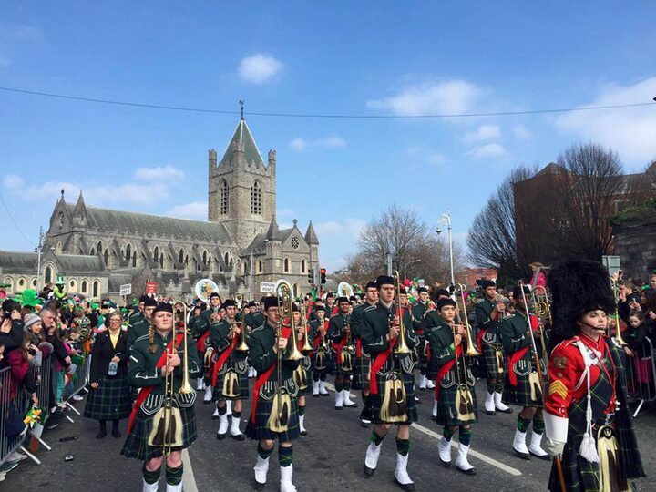

# Shorecrest Pipers Club website

Welcome, and thank you for looking after this site! You do not need to be a developer. Every job below has exact steps you can copy.

## What this site is

This is the website for the Shorecrest High School Pipers Club (Highland bagpiping and drumming, Shoreline, Washington). It is for:

- families, neighbours and friends who find us through a link or a QR code, and who might donate
- students who are curious about joining
- the next club volunteer, who is probably you

It has four pages:

- **Home** (`index.html`): a photo hero with the fundraiser ask (progress line, Donate and Hear us buttons), then a gallery of photo tiles.
- **Fundraiser** (`fundraiser.html`): the story of the current campaign, with a tartan thermometer showing how much has been raised.
- **Events** (`events.html`): where to hear the pipers, with an "Add to calendar" file for each event.
- **History** (`history.html`): a short history of piping at Shorecrest.

The live site is at https://a41bc211b4cd.github.io/shorecrest-pipers/

It is plain HTML, CSS and a little JavaScript. There is nothing to install and nothing to build. If you save a file, that is the change.

## Where things are

| File or folder | What it is | Edit it? |
| --- | --- | --- |
| `index.html` | Home page and photo gallery | Yes |
| `fundraiser.html` | Fundraiser page and thermometer | Yes |
| `events.html` | Events page | Yes |
| `history.html` | Club history page | Yes |
| `events/` | Calendar files (`.ics`) that the Events page links to | Yes, to add events |
| `print/` | Printable QR-code sign (`sign.html`) and table tent (`table-tent.html`) | Via the QR script |
| `tools/` | Small helper scripts (QR codes, photo sizing, share images) | Rarely |
| `images/share/` | The 1200×630 pictures shown when a link is shared | Via the script |
| `sitemap.xml` | List of pages for search engines | When pages or the web address change |
| `assets/js/nav.js` | Writes the menu (including the gold Donate button), the footer and the tab icons on every page | Yes |
| `assets/css/pipers.css` | Our colours and layout changes | Yes |
| `assets/css/main.css` | The template's own CSS (we don't use its Sass sources, so they aren't in this repo) | **No**, leave it alone |
| `assets/js/main.js` and the other template `.js` files | The template's scripts (the photo pop-up, the footer panel) | No |
| `images/thumbs/` | Small gallery pictures shown on the home page | Yes, to add photos |
| `images/fulls/` | Large versions shown when someone clicks a tile | Yes, to add photos |
| `favicon-32.png`, `apple-touch-icon.png` | The tab icon and the phone home-screen icon (these are what `nav.js` links) | Replace to change them |
| `favicon.png` | The original, larger icon | Replace to change it |
| `robots.txt` | Tells search engines and bots what they may do | Rarely |
| `LICENSE.txt` | The template's licence | **No**, never change it |

A rule of thumb: our changes go in `pipers.css`. Its last section is an accessibility block that must stay **last** in the file (it wins over the rules above it), so add new rules above it.

The template's `main.css` is generated code, so anything you edit there is hard to track and easy to break.

## See your changes before anyone else does

You will need Python 3, which is already on most Macs and Linux computers.

1. Open a terminal in the site folder.
2. Run:

   ```
   python3 -m http.server 8123
   ```

3. Open http://localhost:8123 in your browser.
4. Edit a file, save it, and refresh the browser tab to see the change.
5. When you are done, go back to the terminal and press `Ctrl+C`.

If you double-click the HTML files instead, some things may not look right. Use the steps above.

## Update the fundraiser total

This is the job you will do most often.

1. Open `assets/js/campaign.js`. It is a short file, and the last line looks like this:

   ```
   window.PIPERS_CAMPAIGN = { goal: 6000, raised: 1010 };
   ```

2. Change the number after `raised:` to the new total, with no `$` and no comma. For example, `raised: 2350`.
3. Save, check it at http://localhost:8123/fundraiser.html, then publish (see below).

You can also do this without any tools: open `assets/js/campaign.js` on GitHub, click the pencil icon, change the number and commit. The live site updates about a minute later.

The tartan fill and the words "Raised so far: $... of $6,000" both update themselves from that one number. Any other page that shows the progress (such as a home-page banner) reads the same file, so this is the only place to change it.

`fundraiser.html` also keeps a backup copy of the two numbers near the bottom of its script (`var CAMPAIGN = window.PIPERS_CAMPAIGN || { goal: 6000, raised: 1010 };`). It is only used if `campaign.js` fails to load. Changing it does **not** update the site, but it is good to keep it roughly in step.

`goal` sets the scale of the thermometer. If you ever change it, the dollar labels beside the thermometer ($1,000, $2,000 and so on) do not move on their own. They are drawn by hand as tick marks in the SVG in `fundraiser.html`, so you would need to edit their labels and move their positions to match. Most of the time, leave `goal` alone.

## Add a photo tile to the home page

1. Pick a photo. Please make sure you have permission to post it, especially if students are in it.
2. Put your original photo in a folder **outside** `images/` (for example `~/pipers-originals/`), named simply, with no spaces, for example `13.jpg`. Keep the originals there so they never lose quality by being squashed twice.
3. Make the website sizes with the helper script (it needs [ImageMagick](https://imagemagick.org), the `magick` command):

   ```
   sh tools/optimize-images.sh ~/pipers-originals 13
   ```

   Leave off the `13` to do every photo in the folder. For each photo it writes a compressed large picture to `images/fulls/13.jpg` (at most 1600 pixels across, kept under about 300 KB) and a 720-pixel-wide small one to `images/thumbs/13.jpg`. It overwrites files with the same name.
4. Open `index.html` and find the gallery tiles. Each one looks like this:

   ```html
   <article class="thumb">
       <a href="images/fulls/09.jpg" class="image"></a>
       <h2>Pipers Club</h2>
       <p>We meet Tuesdays and Thursdays after school all year. Everyone is welcome!</p>
   </article>
   ```

5. Copy a whole tile, from `<article` to `</article>`, and paste it where you want the new one. Tiles appear in the order they are written.
6. Change the two image names, the `alt` text (a short description for people who cannot see the picture), the heading and the sentence.
7. Save and refresh your preview.

### The fundraiser tile is different on purpose

The fundraiser tile is commented out now (the home page hero does its job), but its code is kept. If you bring it back, note it has an extra `onclick="window.location.href='fundraiser.html'; return false;"`. Please do not remove it. The pop-up photo viewer (the "lightbox") grabs every link in the gallery and tries to open it as a picture, so a normal link to a page would break. The `onclick` sends people straight to the page instead. If you ever make another tile that links to a page rather than a photo, copy the fundraiser tile and change the page name.

### Retire a tile

Do not delete it. Wrap it in a comment so you can bring it back later:

```html
<!--
<article class="thumb">
    ...
</article>
-->
```

Make sure there is no other `<!--` comment inside the tile, because comments cannot be nested.

## Add an event

The Events page lists where the pipers will be. Please delete events once they have passed.

1. Open `events.html` and find the grey comment "HOW TO ADD AN EVENT". It holds a template that looks like this:

   ```html
   <li>
       <span class="event-date">Month D, YYYY &middot; time</span>
       <strong class="event-name">Event name</strong>
       <p class="event-details">Place. What we'll play.</p>
       <p class="event-details"><a href="events/your-event.ics" download>Add to calendar</a></p>
   </li>
   ```

2. Copy the template (just the `<li>` to `</li>`), paste it into the `<ul class="event-list">` list below it, in date order with the soonest first, and fill in the date, name and details. Only write details you have confirmed. The page still has `TODO(club)` notes where the Spree Trees location and times are missing.
3. The "Add to calendar" line is optional. If you want it, copy `events/spree-trees-2026.ics` to a new name such as `events/your-event.ics`, then open it in a text editor and change `UID` (make it unique), `DTSTART`, `DTEND`, `SUMMARY` and `DESCRIPTION`. For an all-day event the end date is the day **after** the last day. If you do not want a calendar file, delete the "Add to calendar" line.
4. Save and check it in your preview.

## Change the menu or the footer

The menu at the top, the footer at the bottom (club blurb, social icons, contact form) and the tab icon are all written by one file, `assets/js/nav.js`. Change it once and every page updates.

- **Menu:** near the top of the file is a list called `links` (Events, Fundraiser, History, About). Each line is one menu item with an address (`href`), an icon name and a label. Copy a line to add an item, delete a line to remove one. Icon names come from [Font Awesome](https://fontawesome.com/icons) (the free "solid" ones).
- **Footer:** further down is `footerHtml`, which is ordinary HTML written inside quote marks. Edit the words, but keep each piece's quote marks and `+` signs where they are. If you add an apostrophe inside the text, write `&rsquo;` or put a backslash before it (`\'`), or the page will stop working.

- **Donate button:** the gold "Donate" button in the header is one line in `nav.js`, marked "issue #3". It links to the fundraiser page. See "When the campaign ends" for how to remove it.
- **Tab icons:** `nav.js` also adds `favicon-32.png` and `apple-touch-icon.png` to every page.
- **Keyboard and new-tab fix:** further down, `nav.js` saves each header link's address in `data-href` and puts it back after `main.js` has run. This keeps the menu usable with a keyboard and lets people open links in a new tab. Please do not remove it.

Important: on every page, `nav.js` must load **before** `main.js`. That is already true today. If you ever make a new page, copy the scripts block from the bottom of an existing page and keep the order.

## How publishing works

The site is published by GitHub Pages from the `main` branch. Whatever is on `main` is what the public sees.

- When a change lands on `main` (by merging a pull request, or by pushing), GitHub rebuilds the site by itself.
- It takes about a minute. Refresh the live site (hold Shift while you refresh) to see it.
- To check progress, open the **Actions** tab of the repository on GitHub.

Because `main` is public, try changes in your local preview first.

## Printable signs and QR codes

`print/sign.html` and `print/table-tent.html` are signs with a QR code that opens the fundraiser page. To print one, open it in a browser and use File, then Print.

**Please do not print until the final web address is set.** The QR codes currently point at the temporary GitHub address. When the address is final, run this from the site folder (it needs Python 3, and sets itself up the first time):

```
sh tools/make-qr.sh https://YOUR-FINAL-ADDRESS/fundraiser.html
```

This rewrites the QR code and the printed web address on both signs. Always scan the result with a phone before printing. Run it with no address to use the default GitHub address.

## If the web address changes

The full web address is written in several places, so when it changes do a find-and-replace of `https://a41bc211b4cd.github.io/shorecrest-pipers/` with the new one in:

- the `og:` and `twitter:` meta tags near the top of `index.html`, `history.html` and `fundraiser.html` (`events.html` has no share tags yet, so there is nothing to change there until someone adds them)
- `sitemap.xml`
- `robots.txt` (the `Sitemap:` line)

Then:

1. Run `sh tools/make-qr.sh https://NEW-ADDRESS/fundraiser.html` to redo the printable signs.
2. Run `sh tools/make-share-images.sh` only if the photos behind the share pictures have changed. It rebuilds the two 1200×630 link-preview pictures in `images/share/` from `images/fulls/fundraiser.jpg` and `images/fulls/01.jpg`, and needs ImageMagick. The wording on those pictures is written inside the script.
3. Check a shared link and a QR scan on a phone.

## Working with GitHub, step by step

The repository is `a41bc211b4cd/shorecrest-pipers`. You need a GitHub account that has been given access to it.

**Issues** are the to-do list. Each issue says what needs doing and why. Before starting, look for an open issue about your job. If there is none, click **New issue** and describe it in a sentence or two. You can comment on issues, so ask questions there.

**Pull requests** (PRs) are how a change gets onto the site. A PR says "here is my change, please check it, then add it to `main`".

1. Get the code: `git clone https://github.com/a41bc211b4cd/shorecrest-pipers.git`, then `cd shorecrest-pipers`.
2. Make a branch for your change (a branch is your own copy to work in, so `main` stays safe):

   ```
   git switch -c update-fundraiser-total
   ```

3. Make your edits and check them in the preview.
4. Save them as a commit:

   ```
   git add -A
   git commit -m "Update fundraiser total"
   ```

5. Send the branch to GitHub:

   ```
   git push -u origin update-fundraiser-total
   ```

6. On GitHub, click **Compare & pull request**. Give it a clear title and a sentence about what you changed. If it finishes an issue, write `Closes #12` (using the real issue number) in the description, and the issue will close itself when the PR is merged.
7. Ask another volunteer or adult to look it over. When they are happy, click **Merge pull request**. The site updates in about a minute.

If you get stuck or something looks wrong, do not panic. Nothing on GitHub is truly lost, and an earlier version can always be brought back. Ask for help in the issue.

## When the campaign ends

When the fundraiser is over, switch the site from asking to thanking. Do these together:

1. **Thermometer:** in `assets/js/campaign.js`, set `raised` to the final total. In `fundraiser.html`, change the heading and the opening paragraph to a thank-you, for example "We did it, thank you!" Change the "Raised so far..." wording (set by the `textContent` line in the script at the bottom) to a past-tense line such as "Raised: $X". Change the note under the thermometer ("We update the tartan as donations come in. Watch it climb.") to something like "Thank you for helping us reach the goal." If the goal was not quite met, keep the thank-you honest and warm instead of saying "we did it".
2. **Donate buttons:** there are two. Remove or comment out the "Donate online" button and the notes about cash and checks on the fundraiser page. Then remove the gold Donate pill from the header: delete the `navHtml += ... class="icon solid fa-heart donate"` line in `assets/js/nav.js` (marked "issue #3") and the "Donate button" block in `assets/css/pipers.css`. Leave the accessibility block at the end of that file alone. Finally search every file for the word `Donate` in case something else was added.
   Also take down or replace any printed signs and QR codes in `print/` that still ask for donations.
3. **Home page hero:** in `index.html`, the hero above the gallery asks for donations. Replace its headline and buttons with a thank-you (or remove the `<section class="hero">`, the "Home page hero" block in `pipers.css` and the `campaign.js`/`hero.js` script tags). The fundraiser tile is already retired. The Events page can stay.
4. **Thank-you note:** add a short thank-you where the donation appeal used to be. Thank the donors, and the people who played and helped. Only include facts you know to be true (what the money bought, when). Keep the names and amounts of individual donors off the site unless they said yes.
5. Check the preview, then publish.

Next year, you can bring all of this back by undoing the comments and updating the numbers and words.

## Credits and licence

The design is **Multiverse** by [HTML5 UP](https://html5up.net) (@ajlkn), used under the Creative Commons Attribution 3.0 licence (CC BY 3.0). The full licence is in `LICENSE.txt`. Please leave that file as it is.

The licence requires that we credit the designer. The footer on every page does this with "Design: HTML5 UP", and it comes from `assets/js/nav.js`. **Please do not remove that credit** when you edit the footer.

Other things the template uses: [jQuery](https://jquery.com), [Poptrox](https://github.com/ajlkn/jquery.poptrox) (the photo pop-up), [Responsive Tools](https://github.com/ajlkn/responsive-tools) and [Font Awesome](https://fontawesome.com) (icons). The original demo images were from Unsplash and are not part of this site.

## Keeping this README current

If you change how the site works (add a page, a script, a folder, a button, or a new way of doing a job), please update this README in the same pull request. Short and accurate beats long and out of date. This guide describes the site as it is on `main` today.
